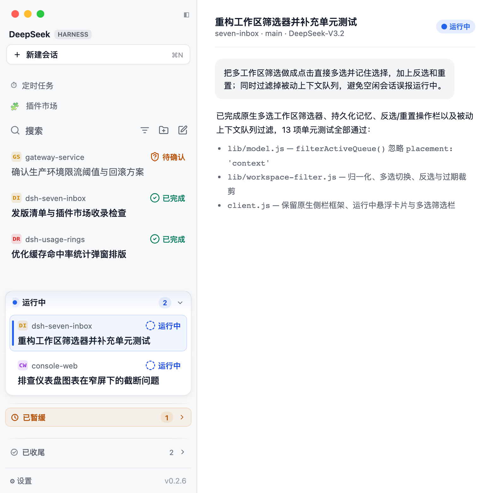
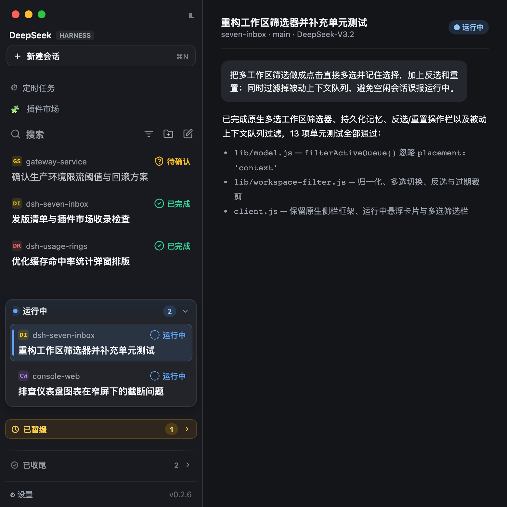
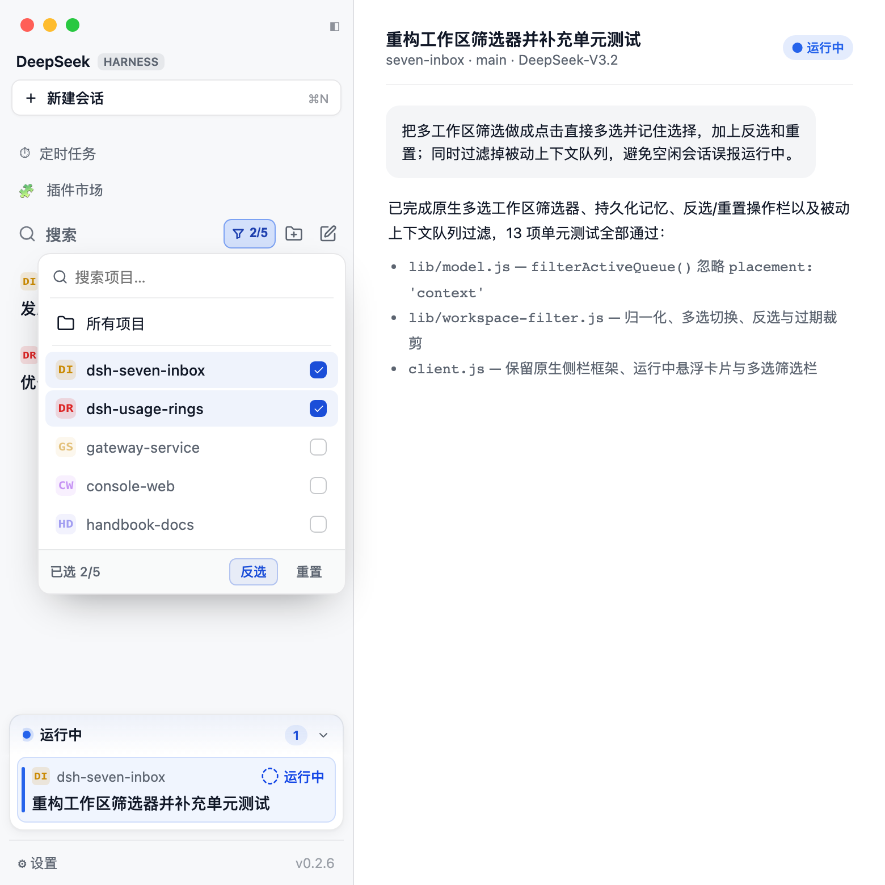

# dsh-seven-inbox (Seven Inbox)

[中文说明](README.md)

An attention-first session inbox sidebar for [DeepSeek Harness](https://github.com/deepseek-ai/deepseek-harness) that replaces only the workspace list while preserving native DSH sidebar chrome, theme, top bar, and footer.

## Screenshots

| Light Mode | Dark Mode | Multi-Workspace Filter |
| :---: | :---: | :---: |
|  |  |  |

## Features

- **Preserves native DSH sidebar chrome**: Replaces only the `sidebar.workspaces` region so the host's native header, New Session button, panel navigation, footer, and theme colors remain intact.
- **Attention-first shelves with distinct hierarchy**:
  - **Active & Needs Input**: Surfaces sessions waiting for approval or user input and unread completed turns at the top.
  - **Working (elevated card)**: Groups actively running threads inside a bottom-anchored floating card with a live pulse dot, count pill, and active-row indicator in both light and dark themes.
  - **Snoozed & Settled**: Separates deferred threads with a warm amber pill header and archived/settled threads with a subtle divider; supports custom snooze presets, quick settle, pin, batch selection, and undo.
- **Persistent multi-workspace filtering**:
  - Click any workspace in the filter popover to toggle multi-selection directly without holding Shift.
  - Automatically remembers selected workspaces in `localStorage` (`dsh-seven-inbox:workspace-filter`) and prunes deleted workspaces.
  - Displays a compact trigger chip (workspace monogram for single selection, funnel icon + `N/M` badge for multi-selection).
  - Includes a sticky footer bar with **Invert** (to quickly exclude selected workspaces) and **Reset** actions.
- **Accurate running state**: Filters out passive context queue entries (`placement: "context"`, such as background memory injections) so idle sessions are not falsely marked as Working.
- **Native-aligned header & bidirectional view switcher**: Mirrors DSH's native Workspaces header (section title with compact filter pill on the left; expandable search, view options, and add project on the right). Switch seamlessly between **Inbox**, **WorkSpace**, **Workspace Tree**, and **In one list** from the same view-options menu in either view, without cluttering the sidebar panel list (Settings toggle remains available).

## Installation

Install from **npm** (recommended):

- Open **Plugins → Add plugin** in DeepSeek Harness and enter `dsh-seven-inbox`;
- Or via the DSH CLI:

```sh
dsh plugin add dsh-seven-inbox
```

Or install from **GitHub**:

```sh
dsh plugin add https://github.com/sevenqcx/dsh-seven-inbox
```

Or install a versioned release tarball from [GitHub Releases](https://github.com/sevenqcx/dsh-seven-inbox/releases):

```sh
dsh plugin add https://github.com/sevenqcx/dsh-seven-inbox/releases/download/v1.0.2/dsh-seven-inbox-1.0.2.tgz
```

Restart DeepSeek Harness after installation so the host loads the `sevenInbox` service and client bundle.

## Development & Testing

```sh
npm run check
npm test
```

## Credits & License

Built on top of the MIT-licensed attention-inbox architecture originally created by [tungloong](https://github.com/tungloong), extended with native chrome preservation, elevated light/dark shelf styling, persistent multi-workspace filtering with invert/reset controls, and passive-context queue filtering.

Licensed under the [MIT License](LICENSE).
