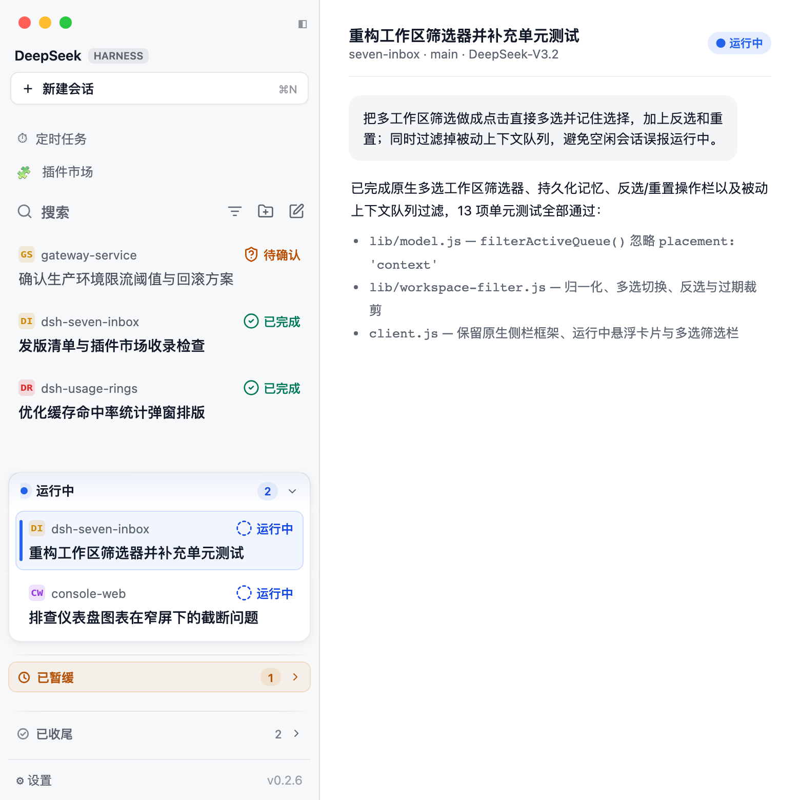
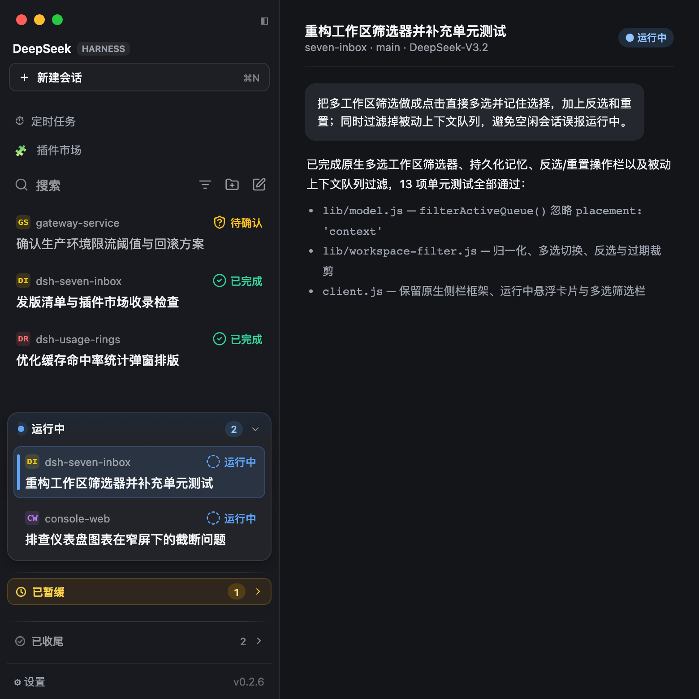
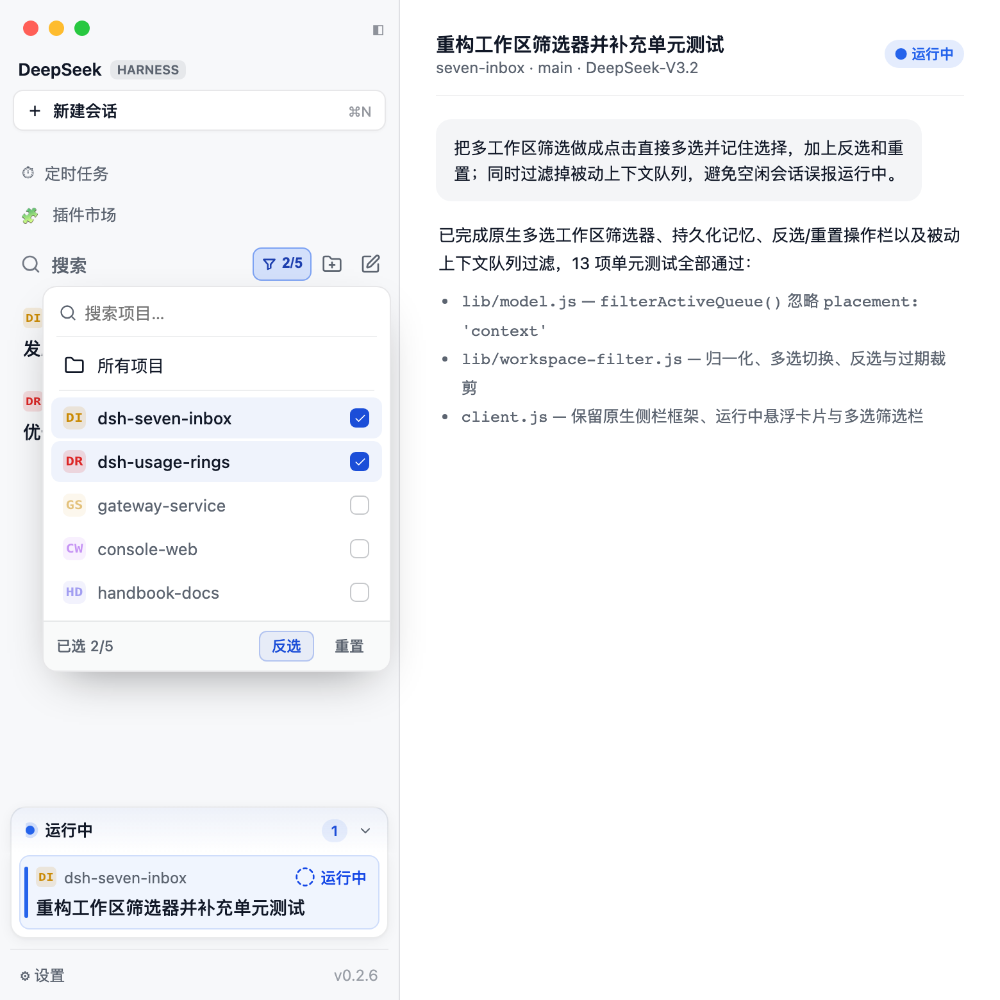

# dsh-seven-inbox（Seven 收件箱）

[English](README.en.md)

面向注意力流转的 [DeepSeek Harness](https://github.com/deepseek-ai/deepseek-harness) 会话收件箱插件：只替换工作区列表区域，完整保留 DSH 原生侧栏框架、顶栏、底栏与宿主主题。

## 界面预览

| 浅色模式 | 深色模式 | 多工作区筛选（反选与记忆） |
| :---: | :---: | :---: |
|  |  |  |

## 主要特性

- **保留原生侧栏框架**：仅接管工作区列表区域，保留 DSH 原生顶栏、新建会话按钮、面板入口、设置底栏与当前浅/深色主题。
- **清晰的注意力分组与视觉层次**：
  - **待输入与活跃**：将等待确认/输入和刚完成的未读会话优先展示在顶部。
  - **运行中悬浮卡片**：将正在执行的会话收进沉底悬浮卡片，浅色与深色模式均配有脉冲蓝点、计数徽标和当前会话高亮条。
  - **已暂缓与已收尾**：暂缓分组采用琥珀色胶囊样式，收尾分组采用轻分隔样式；支持自定义暂缓预设、快捷收尾、置顶、多选批量操作与撤销。
- **工作区多选筛选、记忆与反选**：
  - 点击筛选面板中的工作区即可直接勾选多选，无需按住 Shift。
  - 自动持久化筛选状态并在重开后恢复，同时自动清理已移除的工作区。
  - 筛选按钮单选时显示项目徽章，多选时自动切换为 `漏斗 + N/M` 计数胶囊。
  - 底部操作栏提供「反选」（快速排除指定工作区）与「重置」按钮。
- **精准运行状态识别**：派生运行状态时自动过滤 `placement: "context"` 的被动上下文队列（如记忆插件静默注入），避免空闲会话误报为「运行中」。
- **与原生工作区一致的顶部栏与双向视图切换**：收件箱顶部栏采用与 DSH 原生「工作区」一致的布局（左侧标题与紧凑筛选徽标，右侧展开式搜索、视图选项与添加项目）；点视图选项图标即可在「收件箱 / 按工作区 / 按工作区树 / 单列表」之间直接来回切换，不再往侧边栏多塞单独的切换行（设置页开关依然保留）。

## 安装

推荐优先通过 **npm** 安装（免构建脚本授权）：

- 在 DeepSeek Harness 客户端中打开 **插件 → 添加插件**，输入 `dsh-seven-inbox` 安装并启用；
- 或通过 DSH 命令行安装：

```sh
dsh plugin add dsh-seven-inbox
```

同时保留 **GitHub** 安装通道：

```sh
dsh plugin add https://github.com/sevenqcx/dsh-seven-inbox
```

或安装 [GitHub Releases](https://github.com/sevenqcx/dsh-seven-inbox/releases) 中的正式发行包：

```sh
dsh plugin add https://github.com/sevenqcx/dsh-seven-inbox/releases/download/v1.0.2/dsh-seven-inbox-1.0.2.tgz
```

安装完成后重启 DeepSeek Harness 即可生效。

## 检查与测试

```sh
npm run check
npm test
```

## 致谢与许可

本插件基于 [tungloong](https://github.com/tungloong) 开源的 MIT 许可注意力收件箱核心构建，在其基础上整合了原生侧栏框架保留、浅/深色悬浮卡片与分组层次美化、多工作区持久筛选（含反选/重置）以及被动上下文队列误报修复。

基于 [MIT License](LICENSE) 开源。
